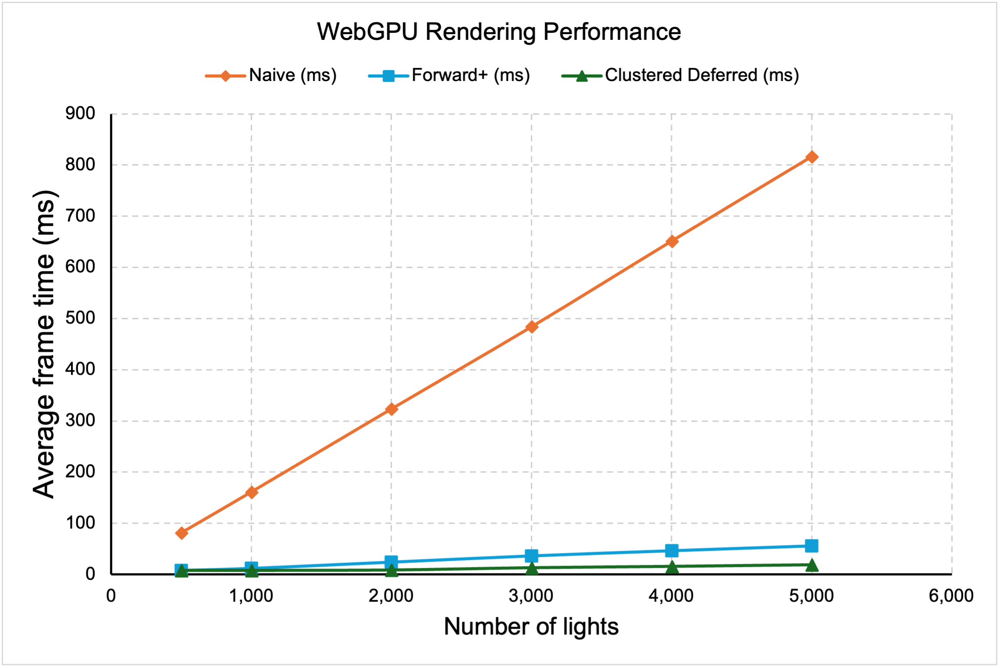
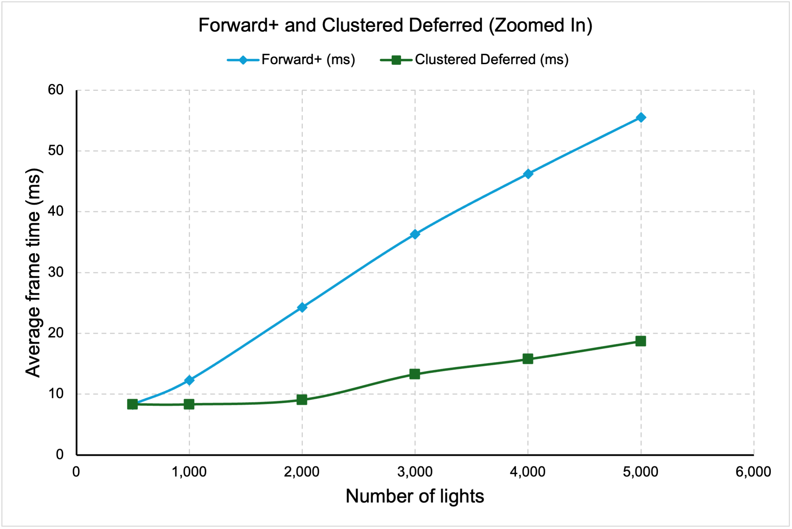

WebGL Forward+ and Clustered Deferred Shading
======================

**University of Pennsylvania, CIS 565: GPU Programming and Architecture, Project 4**

* Ryan Morris
* Tested on: **Google Chrome 154.0.8037.98** on
  macOS 15.1, M4 Pro, 48GB memory

### Live Demo

### Demo Video/GIF

### Features

**Naive**
- In the naive version, the fragment shader (`src/shaders/naive.fs.wgsl`) loops over every light in the scene from the LightSet storage buffer for each fragment, leading the cost to scale with fragments * lights, which is why you see a linear increase with lights in the chart below

**Forward+**
- In the forward+ implementation, I implemented a second buffer, the ClusterSet storage buffer. Dividing the scene into a 16 × 9 × 24 grid of clusters (screen-space tiles × exponential depth slices), I store the lights which belong to each slice
- A compute shader (`src/shaders/clustering.cs.wgsl`) builds a bounding box for each cluster and assigns every light whose sphere intersects it (up to 500 lights per cluster) into that cluster
- The fragment shader (`src/shaders/forward_plus.fs.wgsl`) finds its cluster from screen position and view depth, and shades with only that cluster's lights

**Clustered Deferred**
- The clustered deferred implementation builds upon forward+, reusing the light clustering
- The core addition is the G-buffer pass prior to pixels being lit. Color (`rgba8unorm`), normal and world position (`rgba16float`) are written to the G-buffer for the closest z position at each pixel, removing the overdraw of duplicate work for parts of the scene which are hidden from view
- Fullscreen pass: After the G-buffer pass is complete, read the G-buffer and shade each pixel once using its cluster's lights, avoiding lighting overdrawn fragments

### Performance Analysis

*(timings in ms)*

**Forward+ vs. Clustered Deferred Optimizations**

Clustered Deferred is strictly faster than Forward+ for all numbers of lights which I have tested. On my screen, I was capped at 120fps (8.33 ms frame render time). Below you can see a chart of the frame render times for the different implementations

Average Framerates (averaged over measurement of 25+ frames)
| Number of lights | Naive (ms) | Forward+ (ms) | Clustered Deferred (ms) |
|---:|---:|---:|---:|
| 500 | 81.43 | 8.33* | 8.33* |
| 1,000 | 161.37 | 12.32 | 8.33* |
| 2,000 | 323.57 | 24.29 | 9.07† |
| 3,000 | 484.21 | 36.31 | 13.28 |
| 4,000 | 651.79 | 46.24 | 15.76 |
| 5,000 | 817.02 | 55.52 | 18.72 |

\* Framerate capped on 120fps display

† Reported capped, with some hitches

*Discussion*

Clustered Deferred matches or beats Forward+ at every light count, and the gap widens as lights increase: at 5,000 lights it is roughly 3x faster (18.72 ms vs. 55.52 ms), and both are far ahead of Naive (about 15x and 44x faster, respectively). Above 2,000 lights, Forward+ frame time grows by about 10.4 ms per 1,000 lights versus about 2.7 ms for Deferred. 

Since both renderers share the same clustering compute pass, the difference comes from shading. In Forward+, the per-cluster light loop runs for every fragment, including fragments later discarded by the depth test which are not in view in the scene. To fix this issue, deferred resolves visibility first in a cheap G-buffer pass and then runs the light loop exactly once per visible pixel, so its advantage grows as each loop gets longer with more lights.

However, we might expect a tradeoff in additional overhead and memory cost for the G-buffer and the G-buffer pass. The G-buffer also makes it more difficult to support certain features, like a multi-sample antialiasing (would need to store multiple items for each position in the G-buffer, negating its usefulness) and also the type of material it is. At all of the measurements we took, deferred is the better choice. Given that forward+ is able to fully support my display maximum (120fps) at fewer lights, it may be better to use Forward+ for lower memory overhead and more feature support in these circumstances

### Credits

- [Vite](https://vitejs.dev/)
- [loaders.gl](https://loaders.gl/)
- [dat.GUI](https://github.com/dataarts/dat.gui)
- [stats.js](https://github.com/mrdoob/stats.js)
- [wgpu-matrix](https://github.com/greggman/wgpu-matrix)
